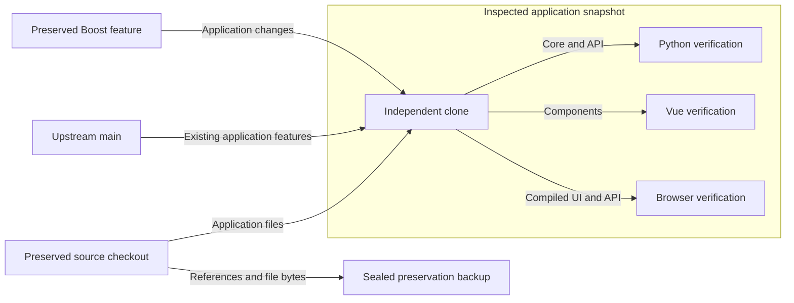
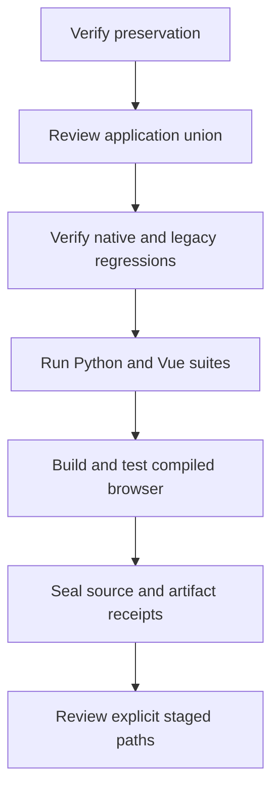

# Application consolidation preserves source data and passes local verification
ACV-2026-11-11 · Codex · 2026-11-11 · Status: In review · Version 1.0
Audience: Maintainers reviewing the application consolidation pull request.

## R. Revision history

| Version | Date | Author | Change | Decisions |
|---|---|---|---|---|
| 1.0 | 2026-11-11 | Codex | Record the inspected application union and local verification. | D-001, D-002 |

## 0. Executive summary

[M] The isolated application union passed 2,219 Python tests, 598 Vue tests, and 13 compiled-browser cases. One optional historical RAW capture test skipped. Package Ruff reported zero findings. A Qt-blocked import check found 104 API method paths across 32 scientific modules and the server.

[M] The source proof verifies 374 original application files without changing their source bytes. It records 356 exact copies and 18 reviewed union or documentation-link changes. The reviewed application set contains 390 paths, including one workflow adjustment. New verification receipts are additional artifacts.

The union includes the scalar Boost switching-loss feedback feature. Archive cleanup and the documentation publishing branch remain outside this snapshot. Existing branch references and worktrees remain available. This record supports application review. It does not assert that every branch head is an ancestor of remote main.

## 1. Context and idea

The application source and upstream features occupied different histories and working trees. Seventeen files required a three-way content union. An independent clone held the combined application while the original source checkout remained unchanged.

Figure 1 shows the verification boundary. Qt serves only as a historical screenshot reference.

Figure 1. The independent clone isolates verification from the preserved source checkout.

## 2. Objective

The audit checks zero original source changes, zero staged deletions, preserved upstream application behavior, and successful combined local verification.

## 3. Requirements

Table 1 lists the constraints that control this audit.

| ID | Requirement | Value or limit | Source | Priority |
|---|---|---|---|---|
| R-01 | Preserve original application files and historical reports. | Exact source hashes | User preservation instruction | Required |
| R-02 | Preserve application features across the histories. | Review all 17 overlap files | Application consolidation scope | Required |
| R-03 | Retain native evidence and flat legacy records. | No silent data loss or implicit overwrite | Native and lifecycle contracts | Required |
| R-04 | Verify the browser application without Qt. | Zero Qt imports | Accepted web migration direction | Required |
| R-05 | Exclude archive cleanup, private configuration, and publishing outputs. | Zero such staged paths | Application-only scope | Required |

Table 1. Preservation and application behavior define the audit limits.

## 4. Method

1. Verify the sealed backup hashes.
2. Copy explicit application files into the independent clone.
3. Merge overlap files against their common base.
4. Verify native and legacy editor behavior.
5. Run the selected Python and Vue tests.
6. Build the browser application without clearing existing outputs.
7. Run the compiled-browser cases on an isolated database copy.
8. Record source hashes and artifact identities.

Figure 2 shows the verification sequence.

Figure 2. Source and artifact receipts follow successful application checks.

The Python selection uses `--noconftest` and `--import-mode=importlib`. Every run uses a new temporary directory. Imports resolve inside the independent clone. Tests do not execute Qt.

The compiled-browser recipe changes port 8002 to 8003 and the application entry point to `/index.html`. Functional assertions and selectors remain unchanged. Two cases use mocked UI responses. Other cases use actual API calculations or generation, with some controlled stale-response tests.

## 5. Local verification passed within the inspected scope

Table 2 records measured local results. Runtime values describe this machine and snapshot.

| Check | Result [M] | Process time | Peak resident set size |
|---|---|---|---|
| Combined Python, 76 files | 2,219 passed, 1 skipped | 144.58 s | 566,804 KiB |
| Focused native, DPT, and backup | 145 passed | Not measured separately | Not measured |
| Vue, 55 files | 598 passed | 45.28 s | 515,428 KiB |
| Package Ruff | 0 findings | Not measured | Not measured |
| Qt-blocked imports | 32 scientific modules, 104 API method paths | 3.19 s | 245,456 KiB |
| Production build | 204 transformed modules | 4.91 s | 568,540 KiB |
| Compiled browser | 13 passed | 38.64 s | 349,528 KiB |

Table 2. The combined local suites and compiled application checks passed.

The skipped case is `test_fresh_ltspice_binary_complete_waveform_and_native_archive`. The optional `TDB_GENERIC_DPT_RAW` was not configured for the 2026-11-11 consolidation run. Separate native RAW tests cover real reader imports and independent 2 mJ / 4 mJ energy checks.

[M] The Python source manifests contain 237 paths with zero start-to-end changes. The browser database check preserves all 24 copied source files, totaling 28,903,083 bytes. No database file enters the evidence directory.

[M] The production build retains its existing warning about a JavaScript chunk above 500 kB. The inspected compiled index SHA-256 is `3bec747f622ede3bd8b8114abafdf8b2450b501fab04f355db973b137da51a07`.

## 6. The union preserves format and provenance boundaries

Decision D-001 records the isolation method. Decision D-002 records the fresh evidence method.

The union retains upstream database lifecycle, backup, curve editing, thermal, DPT, and topology capabilities. It adds the preserved scientific routes and browser workbenches. The source proof enumerates all 17 overlap paths and all 18 changed source copies.

Native editors retain the version-2 core archive and untouched evidence. Existing flat legacy records retain their wire format. Atomic creation and additive backup restore retain no-overwrite behavior. Unrepresentable native edits fail before persistence.

Native RAW imports retain exact import provenance in a reserved evidence mapping. Named evidence fields mirror the source identity and available scalar conditions. New acquisitions name `spicelib.RawRead`. Historical `PyLTSpice.RawRead` provenance remains accepted.

Recorded switching curves remain visible even when their DPT source is unknown. Separate qualified flags require structured event evidence. The generic netlist template requires explicit user selection. Thermal comparison retains valid measured curves and R/C or R/tau models, with per-component diagnostics.

Table 3 records the audit-method alternatives.

| Option | Preservation | Review cost | Verdict |
|---|---|---|---|
| Independent clone and three-way union | Retains source checkout and upstream features | Requires 17 overlap reviews | Selected |
| Source snapshot commit and sequential cherry-picks | Retains commit boundaries | Active source hooks would change source documentation | Not selected |

Table 3. Isolation preserves the original source checkout during consolidation.

Local verification does not establish full numerical equivalence across all historical inventory definitions. The compiled browser set contains two fully mocked UI cases. Laboratory measurements and exhaustive reference-data portability remain outside this audit.

An earlier main-branch [CI run 38482209038](https://github.com/tinix84/transistordatabase/actions/runs/38482209038) failed on 133 existing style findings. This audit does not claim that gate passed. Two existing workflow commands now specify `--noconftest`. Test names, style gates, and documentation jobs remain intact.

## 7. The evidence supports application review

Table 4 states the audit conclusions.

| # | Conclusion | Basis | Confidence | Evidence |
|---|---|---|---|---|
| 1 | Original application files and historical reports retain their source bytes. | M | High | Source proof and preservation seal |
| 2 | The combined local application tests pass within their stated scope. | M | High | Python and verifier manifests |
| 3 | Native and legacy editor paths retain their format and provenance contracts. | M, C | High | Focused regressions and native RAW energy checks |
| 4 | Remote CI and exhaustive historical numerical parity remain unverified by this record. | M | High | Earlier CI result and stated test limits |

Table 4. Conclusions remain bounded by the retained evidence.

## 8. Next steps

| # | Action | Owner | Due date |
|---|---|---|---|
| 1 | Review explicit staged paths and normal hook changes. | Repository maintainer | 2026-11-11 |
| 2 | Review and merge the application pull request. | Repository maintainer | 2026-11-11 |
| 3 | Preserve local-only historical commits when updating the original main reference. | Repository maintainer | After remote merge |

## 9. Decision log

### D-001: Isolate the application audit

**Date:** 2026-11-11 · **Version:** 1.0 · **Supersedes:** None

**Decision:** Use an independent clone for the application union.

**Why:** Source hashes remain unchanged while the combined application passes local verification [M, Tables 2 and 4].

| Option | Pros | Cons |
|---|---|---|
| Selected: independent clone | Preserves the source checkout and private state | Requires explicit source and artifact mappings |
| Source snapshot commit | Keeps a direct source commit boundary | Active hooks change source documentation |

**Consequences:** Review source mappings before publication. Preserve original worktrees and references.

### D-002: Retain a new verification record

**Date:** 2026-11-11 · **Version:** 1.0 · **Supersedes:** None

**Decision:** Preserve older reports and record this snapshot separately.

**Why:** Exact source report hashes remain available with fresh combined results [M, Source proof].

| Option | Pros | Cons |
|---|---|---|
| Selected: separate dated record | Retains historical evidence and current audit boundaries | Adds a new receipt set |
| Revise older reports | Keeps fewer report files | Changes the evidence attached to earlier snapshots |

**Consequences:** This record does not replace issue status or claim all branch heads are merged by ancestry.

## 10. References and appendices

- [Source preservation proof](application-consolidation-evidence-2026-11-11/source-proof.json)
- [Artifact identities](application-consolidation-evidence-2026-11-11/evidence-artifact-manifest.json)
- [Python results and source manifests](application-consolidation-evidence-2026-11-11/python-manifest.json)
- [Vue, headless, build, browser, and database receipts](application-consolidation-evidence-2026-11-11/verifier-manifest.json)
- [Earlier semiconductor closure record](semiconductor-gap-closure-2026-11-11.json)
- [Preserved Boost feedback verification](boost-switching-feedback-verification-2026-10-15.md)

The sealed preservation backup is `/home/tinix/claude_wsl/merge-preservation-20261111-6a3d7bf0-d340-4d39-8937-8abbc428038e`.

| Artifact | SHA-256 |
|---|---|
| `final-seal.json` | `97c2f019164e0466d342707a8b3d5a38ecd0753fb2a47bc172860f2856c1a463` |
| `all-refs.bundle` | `cda5ff5b80e7598b4f6d45cdf38027403bf5b88bf403f2ab1e69447a7d6fa978` |

The seal records 96 bundle heads, 14 existing worktrees, and 492 unique preserved source files. Missing source paths were recorded without deletion. Private configuration and its local historical commits are excluded from publication. Archive cleanup and `origin/gh-pages` remain separate.
