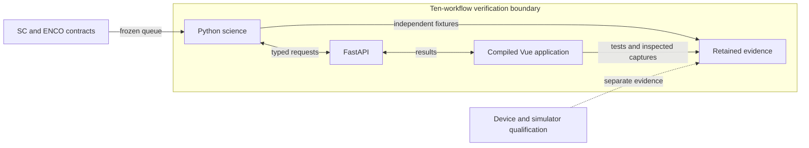
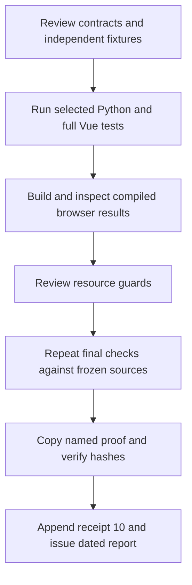

# Ten audited semiconductor workflows have acceptance evidence

Codex · 2026-11-11 · Status: Released audit record · Version 1.0  
Audience: engineers checking the ten selected contracts and their evidence.

## R. Revision history

| Version | Date | Author | Change | Decisions |
|---|---|---|---|---|
| 1.0 | 2026-11-11 | Codex | Record ten-workflow acceptance and final verification | D-001 |

**Table R1.** This issue preserves the earlier released records.

## 0. Executive summary

All ten selected workflows have acceptance evidence at this snapshot [M/C]. The final selected Python run passed 1,869 cases across 64 files. One integration case was skipped because its named RAW fixture was unavailable. All 504 Vue unit tests passed across 50 files.

Eight circuit acceptance cases passed in the compiled browser. Three post-guard cases also passed against the final backend. These populations overlap and must not be added. The blocked-import check loaded 32 scientific modules, the core model and 94 application routes without Qt [M].

The sealed November 10 records and first nine receipts preserve their original evidence. This report establishes acceptance of the ten selected workflows. Full numerical equivalence across all 3,144 inventory definitions remains unverified.

## 1. Context and scope

The [frozen version 1.1 queue](semiconductor-remaining-gaps-2026-11-10.json) defines this report's boundary. The [released record](semiconductor-parity-verification-2026-11-10.md) retains its 25 capabilities, 88 target definitions and 171 evidence files. Its 1,417 Python and 368 Vue passes are historical counts.

Figure 1 shows the verification boundary. The accepted [local web GUI decision](../adr/0001-local-web-gui-replaces-qt.md) remains the product direction.

**Figure 1.** Selected contracts connect to reusable calculations, interfaces and retained proof.

## 2. Objectives

The acceptance criterion is ten traceable receipts for ten selected workflows. Preservation requires zero changed bytes in the sealed reports. Final execution requires zero failures in the selected Python and full Vue suites. The import check requires zero Qt modules loaded.

## 3. Requirements

Table 1 limits the conclusions to traceable evidence.

| ID | Requirement | Value / limit | Source | Priority |
|---|---|---|---|---|
| R1 | Preserve historical evidence | Four unchanged report hashes and first-nine receipt prefix | Released records | Required |
| R2 | Trace acceptance | Ten queue IDs and ten receipts | Frozen queue | Required |
| R3 | Preserve scientific absence | Unknown, omitted, estimated and computed zero remain distinct | Contracts and independent tests | Required |
| R4 | Verify reusable science | Python, Vue, compiled browser and blocked Qt imports | Final proof | Required |
| R5 | Bound evidence expansion | Declared input and output limits before large allocation | Reviewed guards | Required |

**Table 1.** Acceptance requires bounded behavior and preserved provenance.

## 4. Method and repeatability

The Python selection combines the previous 45 safe files with 19 follow-on files. Checks ran serially after the WSL restart. Figure 2 shows the evidence sequence.

**Figure 2.** Final verification follows guard review and retains the named proof.

1. Read the [machine-readable report](semiconductor-gap-closure-2026-11-11.json).
2. Verify its frozen report hashes.
3. Verify retained copies against the [artifact manifest](semiconductor-parity-evidence-2026-11-11/artifact-manifest.json).
4. Read the matching receipt and usage guide.
5. Repeat the selected tests with the required fixtures.

Evidence tags mean inspection or observed execution **[M]**, simulation **[S]**, calculation **[C]**, estimate **[E]**, and assumption **[A]**. The JSON supplies the exact selection, source hashes, counts and artifact mappings.

## 5. Ten workflows have bounded acceptance evidence

Table 2 links each selected workflow to its [receipt](semiconductor-follow-on-verification-2026-11-10.json).

| # | Workflow | Accepted scope [M/C] |
|---|---|---|
| 1 | Electrical stress indices | Four screening proxies retain formulas, units and denominator checks. |
| 2 | Gate-state current allocation | Signed traces conserve supplied current samples. |
| 3 | Reverse current sharing | Bounded common-voltage solution retains conditions and current conservation. |
| 4 | Gate-resistance energy browser queries | Forward and inverse queries retain source inventory and bounded unique crossings. |
| 5 | Conditioned model fitting | Resistance, diode and energy fits retain observations, domains and separate diagnostics. |
| 6 | XYZ energy import | Source bytes, units, duplicates, zero, missing observations and holes remain distinct. |
| 7 | Three-axis energy display | Original observations, source-connected faces and drawing limits remain explicit. |
| 8 | Complex spectra and grouped exports | Phase, qualifying frequency bins and discrete versus time-weighted statistics remain distinct. |
| 9 | Weighted multi-objective merit | Common population, exclusions, contributions, extrema and tied ranks remain inspectable. |
| 10 | Physical circuit summary | Member, die and junction ownership retain losses, null coverage and tied hottest junctions. |

**Table 2.** Receipts 1–10 retain their individual entry points, source identities and limits.

Table 3 gives the completed final results. Earlier focused runs overlap these counts.

| Check | Result [M] | Duration | Peak RSS |
|---|---|---|---|
| Selected Python, 64 files | 1,869 passed, 1 skipped, 0 failures | 112.31 s | 566,244 KiB |
| Full Vue, 50 files | 504 passed | 57.10 s | 362,148 KiB |
| Compiled build | Passed | 17.07 s | 534,324 KiB |
| Circuit compiled acceptance | 8 passed | 43.60 s | 354,376 KiB |
| Final post-guard compiled check | 3 passed | 14.40 s | 316,148 KiB |
| Blocked Qt import | Core, 32 science modules, 94 routes, no Qt | Not recorded | Not recorded |
| Ruff | Zero findings in production package and final converter/circuit tests | Not recorded | Not recorded |
| Narrowed whitespace check | Passed with CRLF-aware configuration | Not recorded | Not recorded |

**Table 3.** Completed runs support the selected software claims.

The skipped case is `test_fresh_ltspice_binary_complete_waveform_and_native_archive`. Its required `TDB_GENERIC_DPT_RAW` fixture was unavailable. The sealed November 10 pass remains historical evidence. The eight-case browser count uses the owner's verified record because its raw log was not retained. The final three-case browser log is retained.

The circuit fixture gives 1 J and 1 W per member over 1 s [C]. Circuit totals are 2 J and 2 W. Independent 10 K/W paths from 25 °C give two tied 35 °C junctions. Omitted heat leaves full temperature null. Acknowledgement exposes a separate known-heat-only 35 °C estimate. The [usage guide](../api/semiconductor-circuit-summary.md) explains ownership and thermal assumptions.

The evidence directory retains 22 byte-identical copies and their manifest. These include final logs, selection, metadata, fourteen reviewed workflow 7–10 captures and the memory incident report. Earlier unavailable artifacts remain explicitly unavailable in their historical receipts.

## 6. Acceptance applies to the selected contracts

Decision D-001 preserves historical records and issues separate dated evidence. Table 4 compares the reporting options.

| Option | Benefit | Limitation | Verdict |
|---|---|---|---|
| Preserve records and append dated evidence | Retains original identity and current acceptance | Readers distinguish dates | Use under D-001 |
| Replace original hashes | Gives one current surface | Removes the original snapshot | Reject |
| Infer full parity from counts | Gives a short coverage claim | Does not establish numerical equivalence | Reject |

**Table 4.** Dated evidence preserves each snapshot's meaning.

Commercial device accuracy requires measurements and calibration under declared conditions. General Excel formula evaluation, VBA execution and Power Query refresh remain outside the verified source-preview workflows. General SPICE device or Simulink model interchange remains unsupported. Native, MAT, PLECS and conditional Gecko workflows retain documented bounds. Version-specific simulator consumer qualification requires separate evidence.

The circuit summary uses constant heat and independent paths to an ideal fixed sink. Shared sink rise, thermal feedback and Foster transients require separate models. The build retains its existing Vite chunk-size warning above 500 kB.

The broader whitespace check flags an extra EOF blank line in `App.vue` and unrelated mixed-line-ending state. App.vue was not changed during this continuation after the WSL restart. The narrowed touched tracked-path check passed.

The [memory report](semiconductor-parity-evidence-2026-11-11/ubuntu-memory-incident.md) records guest memory exhaustion with 16 GB RAM and 8 GB swap. Three Python processes used about 14.7 GB combined RSS at 11:09 CET [M]. Their command lines are unknown. A causal link to Windows `E_UNEXPECTED` remains unproven. Final checks ran serially with process peaks below 600 MB. No RAM setting changed.

A separate bounded review verified a reachable converter evidence-expansion path [M]. Shared preflight now checks repeated metadata before engine evaluation. Streaming requests have a 4,000,000-byte limit. Responses have a 24,000,000-byte limit. No memory-exhaustion reproducer was run. The historical culprit remains unidentified.

The memory bridge was unavailable during earlier context recovery. No matching recent Ubuntu project or worktree transcript was recovered. The final bounded canonical read and updates succeeded. The four remaining tasks and both canonical lists are closed with report links. Automatic capture health remains unverified.

## 7. Evidence supports ten-workflow acceptance

Table 5 limits confidence to the observed contracts.

| # | Conclusion | Basis | Confidence | Evidence |
|---|---|---|---|---|
| 1 | All ten selected workflows have acceptance evidence. | M/C | High | Table 2 and receipts |
| 2 | Final selected Python and full Vue suites have zero failures. | M | High | Table 3 and retained logs |
| 3 | Circuit counting and incomplete heat retain physical meaning. | C/M | High | Independent tests and reviewed captures |
| 4 | Historical records retain their original evidence. | M | High | Frozen hashes and prefix reconstruction |
| 5 | Full definition-level equivalence and commercial accuracy remain unverified. | M/A | High | Declared scope and external qualification limits |

**Table 5.** Confidence applies to software behavior within stated input and model bounds.

## 8. Next steps

Table 6 records conditional external qualification. This dated report does not maintain live task status.

| # | Action | Owner | Due date |
|---|---|---|---|
| 1 | Supply the named RAW fixture before repeating that integration claim. | Test maintainer | TBD, before RAW integration qualification |
| 2 | Supply measurements before a commercial device accuracy claim. | Device-model owner | TBD, before device qualification |
| 3 | Identify the exact simulator consumer version before compatibility qualification. | Export consumer | TBD, before interoperability qualification |

**Table 6.** These conditional activities remain outside the ten selected workflows.

## 9. Decision log

### D-001: Preserve historical records and append dated evidence

**Date:** 2026-11-11 · **Version:** 1.0 · **Supersedes:** None.

**Context:** The November 10 records describe a sealed checkout. Later implementation changed shared source files.

**Decision:** Preserve those records and issue separate ten-workflow acceptance evidence. This decision concerns reporting. The accepted web GUI decision governs product architecture.

**Why:** Unchanged hashes preserve original evidence. Final tests establish later selected behavior [M/C, Tables 2–3].

Table 7 compares the reporting options for this decision.

| Option | Pros | Cons |
|---|---|---|
| Chosen: dated report and appended receipt | Preserves four sealed report hashes and nine earlier receipts | Requires date-aware comparison |
| Replace historical hashes | Gives one current surface | Discards original verification identity |

**Table 7.** Separate dated evidence preserves historical identity.

**Consequences:** Historical receipt hashes identify acceptance-time sources. Use the final JSON for the November 11 source snapshot. Repeat current checks after subsequent source changes.

## 10. References and appendices

- [Final JSON report](semiconductor-gap-closure-2026-11-11.json)
- [Ten receipts](semiconductor-follow-on-verification-2026-11-10.json)
- [Artifact manifest](semiconductor-parity-evidence-2026-11-11/artifact-manifest.json)
- [Final verification metadata](semiconductor-parity-evidence-2026-11-11/final-verification-summary.json)
- [Frozen queue](semiconductor-remaining-gaps-2026-11-10.json)
- [Released November 10 report](semiconductor-parity-verification-2026-11-10.md)

### Appendix A. Terms

SHA-256 identifies a Secure Hash Algorithm with a 256-bit digest. JSON means JavaScript Object Notation. CSV means comma-separated values.

API means application programming interface. SI means International System of Units. RSS means resident set size.

Qt names the legacy toolkit. WSL means Windows Subsystem for Linux. VBA means Visual Basic for Applications. SC and ENCO identify the reference source populations.

The JSON records the preserved prefix length and original suffix. Their reconstructed digest equals the original nine-receipt file SHA-256.
