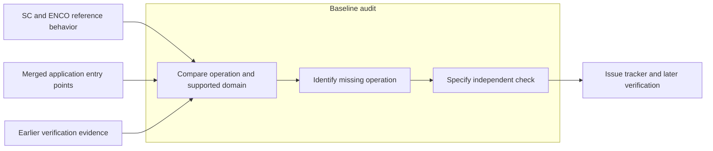
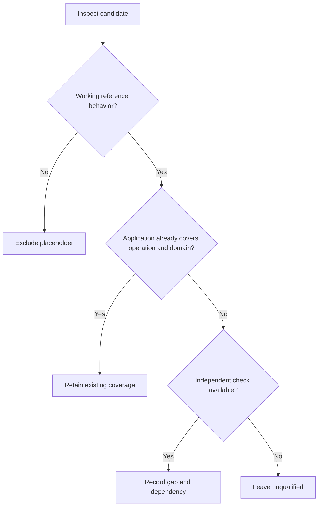

# Seven semiconductor analysis gaps at the merged baseline

Codex · 2026-11-11 · In review · Version 1.0

Audience — semiconductor application maintainers and engineers who verify electrical and thermal calculations.

**Revision history.** Table 1 identifies the audit boundary.

| Version | Date | Author | Change | Record |
|---|---|---|---|---|
| 1.0 | 2026-11-11 | Codex | First comparison at commit `e41cc8a` | D-001 |

## 0. Executive summary

The audit identified seven user-visible operations beyond the ten workflows covered by the November 11 verification record. Hysteretic gate digitization has first priority because a noisy trace can change the event count and calculated energy. Frequency masks have second priority because the baseline already calculates the required spectrum. Three further gaps concern thermal paths, gate settling and temperature-dependent device losses. Two application extensions concern finite Boost sweeps and local simulator jobs.

These findings apply to commit `e41cc8a`. Each entry includes an independent check and a dependency. The issue tracker owns subsequent implementation status.

## 1. Context and scope

The inventory contains 385 SC archive definitions, 1,746 ENCO reference definitions and 1,013 application definitions. The November 11 report qualifies ten selected workflows. Figure 1 shows how this review used both records.

*Figure 1. A missing operation requires reference behavior, an application boundary and a separate engineering check.*

## 2. Objective

Identify a concrete application limit and an independent check for each of seven selected operations.

## 3. Review criteria

Table 2 states the criteria for admission to this audit.

| ID | Requirement | Value or limit | Source | Priority |
|---|---|---|---|---|
| R1 | Trace the baseline | One fixed application commit | Merged repository | Required |
| R2 | Trace the reference | At least one inspected definition per entry | Function inventory | Required |
| R3 | Qualify numerical claims | State units, domain and expected result | Candidate operation | Required |
| R4 | Distinguish missing data | Preserve coverage and failure information | Application contracts | Required |

## 4. Method

1. Read the frozen inventory and the ten-workflow verification record.
2. Inspect each candidate definition and its relevant caller or notebook.
3. Compare the operation with its public application boundary at the baseline commit.
4. Check whether existing calculations cover the proposed result.
5. Derive an independent check for each retained operation.

Figure 2 shows where a candidate left the review.

*Figure 2. The review checks behavior, existing coverage and the verification method before admitting a candidate.*

## 5. Seven operations exceed the audited application boundaries

Table 3 summarizes direct code inspection. The companion JSON identifies each reference file, function, line range and application counterpart. All 13 cited definition records matched their frozen source-file hashes. Calculations [C] below give expected values. Section 5.7 also identifies a separate runtime qualification.

| Order and operation | Baseline observation | Missing operation |
|---|---|---|
| 1. Hysteretic gate digitization | The reference switches above the high threshold and below the low threshold. The baseline uses a binary trace, a single threshold, or explicit event masks. | Convert analog gate voltage to one state per sample with two thresholds. Use the same state history for allocation and switching events. |
| 2. Frequency masks for current spectra | The reference compares magnitude with a limit. The baseline calculates one-sided current amplitudes and selects ten bins for display. | Compare every computed bin with a frequency-indexed limit in peak amperes. Report excess, passing bins and uncovered bins. |
| 3. Simultaneous thermal interfaces | The reference applies separate contact corrections to common, forward and reverse paths. The baseline accepts three aggregate resistances and one sourced contact. | Supply simultaneous contacts for distinct paths. Retain each source, contact area, resistivity and resulting resistance. |
| 4. Gate settling after the Miller plateau | The SC supporting script evaluates a target after the plateau. The baseline derives post-plateau capacitance and ends its turn-on estimate at the plateau. | Report turn-on settling to an explicit finite gate-voltage target, including elapsed time, gate current and charge. |
| 5. Electrothermal feedback from native device curves | The reference recomputes device losses at each trial temperature. The baseline thermal solver accepts a supplied loss table or affine model. The static device loss calculation accepts fixed conditions. | Construct a conditioned loss-versus-temperature table directly from native channel and switching-energy records. Feed the table to the existing fixed-point solver. |
| 6. Boost sweep with switching-loss feedback | The reference evaluates finite configuration lists. The baseline solves a single Boost point with switching-loss feedback. Its sweep rejects this mode. Its separate Pareto result reports conduction losses. | Evaluate a finite list of comparable Boost points with the existing scalar solver. Make switching-loss feedback and source coverage visible for each point. |
| 7. Web execution of a double-pulse simulation | The reference executes a simulator and reads its results. The baseline has a blocking Python runner. The web interface generates a netlist and separately imports RAW waveforms. | Start a locally configured simulator from the web workflow. Associate job state, netlist, executable version, log, RAW waveform and import evidence. |

### 5.1 Hysteretic gate digitization

Specify low < high in volts. Hold state at equality. Infer the initial state only outside the band, or require a seed. Count transitions between known samples only. Keep the existing default.

**Independent check [C].** With low 2.5 V, high 7.5 V, and [0,8,4,6,4,2,10] V, expect [0,1,1,1,1,0,1]. Turn-on uses intervals 0 and 5. Turn-off uses interval 4. At 2 mJ per turn-on and 3 mJ per turn-off, total energy is 7 mJ. Over 6 ms, mean power is 7/6 W.

**Dependency.** A declared initial-state policy, gate units, existing event index convention, and sourced event energies.

**Reference limit.** The reference seeds undecided samples as off. Relative thresholds also need a nonzero measured span. An unknown first sample establishes neither zero current nor a switching event.

### 5.2 Frequency masks for current spectra

An exact coordinate match supports a point limit. Explicit piecewise-linear interpolation can support a declared contiguous segment. Leave mask gaps and out-of-range bins uncovered. Equality passes. Preserve detrending and window normalization.

**Independent check [C].** For eight uniform samples at 8 Hz, use 2 cos(2πn/8) + cos(4πn/8) A. The 1 Hz component exceeds 1.5 A by 0.5 A. Test equality with an exactly representable constant or Nyquist component. A covered zero is a valid measurement.

**Dependency.** Reuse all normalized bins before display selection. The API admits 10,000 samples, or at most 5,001 one-sided bins. Bound the number of mask points.

**Reference limit.** The reference joins equal-length columns by position. Its optional decibel conversion uses a 1 µ-unit reference without checking the quantity. Neither behavior establishes an ampere limit.

### 5.3 Simultaneous thermal interfaces

Require positive contact area and nonnegative resistivity. Compute each added resistance as resistivity divided by area. Apply the common path to total heat and branch paths to their own heat.

**Independent check [C].** Use 25 °C sink temperature, 2 W forward power and 1 W reverse power. With ideal zero base resistances, set contact contributions to 1, 2 and 3 K/W on common, forward and reverse paths. Expect 28 °C shared temperature, 32 °C forward and 31 °C reverse.

**Dependency.** Sourced area and resistivity for each supplied path. Preserve the existing single-contact input.

**Reference limit.** Manual aggregation can already yield the correct temperatures. The gap concerns simultaneous contact inputs and their evidence. A missing resistance needs a declared treatment.

### 5.4 Gate settling after the Miller plateau

Use the baseline constant-capacitance resistive driver model. Specify plateau < target < positive rail. Treat a zero-charge phase explicitly. Preserve the original turn-on result when the option is absent.

**Independent check [C].** With a 10 V rail, 4 V plateau, 7 V target, 2 Ω total resistance and 1 nF post-plateau capacitance, expect 2 ln(2) ns. Gate current changes from 3 A to 1.5 A. The added charge is 3 nC.

**Dependency.** Known gate-charge components and a finite target voltage. Supporting calculation in matlab_func/mosfet_switching_losses.py, lines 74–117.

**Reference limit.** The supporting script samples the nearest plotted voltage. The named switching-loss notebook stops earlier. The estimate describes gate charging and gives no drain switching energy.

### 5.5 Electrothermal feedback from native device curves

Start with one switch at fixed nonnegative current, duty, frequency and thermal resistance. Require current and temperature coverage for each active contribution. Keep distinct gate, voltage and resistance selections for turn-on and turn-off.

**Independent check [C].** For a conduction-only case use 2 A, unit duty, 25 °C sink and 2 K/W. Set R(T) = [1 + 0.01(T − 25)] Ω on a covering interval. The root is 25 + 8/0.92 = 33.69565217 °C. Also exercise temperature-domain exit and nonconvergence.

**Dependency.** At least two temperatures per active matched curve family. Identify source records, temperature coverage, measured operating conditions and file hash. An inactive event contribution can be zero by construction.

**Reference limit.** The reference returns its last value after its iteration limit. Publish convergence, residual and domain exits. The Fuji example records +15 V on turn-on and −15 V on turn-off. Their field meanings require explicit selection.

### 5.6 Boost sweep with switching-loss feedback

Start with one frequency axis and fixed supply, load and device conditions in continuous conduction mode. Bound the grid. Retain ties and rejected points. Rank only comparable loss scopes and sourced objectives.

**Independent check [C].** Each valid grid point must reproduce an independent scalar request. Check power balance and volt-second balance. Exercise zero-energy and ideal-resistance limits. An unsupported energy curve or a discontinuous-conduction point needs a diagnostic.

**Dependency.** The qualified scalar solver, curve-condition coverage, and a per-request work bound. Cost or volume rankings require a common sourced population.

**Reference limit.** The SC Pareto notebook shows linked catalog scatter plots. Its bridgeless converter calculation concerns a different circuit. Neither supplies a numerical Boost feedback oracle.

### 5.7 Web execution of a double-pulse simulation

Use a fresh job directory and a supported generated netlist. Bound duration and simultaneous jobs. Report cancellation, process exit and output validation. Preserve previous job files.

**Independent check [C].** Run a real resistor-capacitor step. At one time constant the voltage fraction is 1 − exp(−1). Then verify pulse timing and inductor-current rise on a double-pulse fixture. Check the netlist, log and RAW hashes from that job.

**Dependency.** A configured executable accessible to the local service, a validated simulator invocation, and the existing RAW import path. A generic switch model supports workflow verification only.

**Reference limit.** The reference removes existing output and does not establish a successful exit before loading results. A separate Windows-native LTspice 26.0.1.0 RC run and WSL waveform decode passed. Launching the Windows executable directly from WSL remains unverified.

The local simulator produced 1,018 samples for a 1 ms time constant. The maximum absolute error was 0.791 µV against a 200 µV limit [S]. This qualification covers Windows-native simulation and WSL waveform decoding. The complete web job remains unverified at the baseline.

## 6. Gate state directly controls event energy

A false gate transition can add an entire turn-on or turn-off energy. A two-threshold comparison can use the existing event and allocation calculations. Frequency masks can use the existing spectral normalization. Native device feedback and simulator execution depend on additional source or runtime qualification. Decision D-001 sets the audit boundary.

The catalog notebook `tests/pareto_sc.ipynb` contains linked scatter plots. The archived `docs/Mosfet_switching_losses.ipynb` illustrates earlier gate intervals. Their supporting scripts supply context for entries 4 and 6. Neither notebook establishes measured switching energy for those entries.

## 7. Processing and integration require different evidence

Table 4 separates observed limits, calculated expectations and unverified integration.

| # | Conclusion | Basis | Confidence | Evidence |
|---|---|---|---|---|
| 1 | Gate states and spectral limits have direct numerical checks. | Source inspection and C | High | Sections 5.1–5.2 |
| 2 | Thermal interfaces and gate settling have closed-form checks. | Source inspection and C | High | Sections 5.3–5.4 |
| 3 | Source coverage controls device feedback and Boost comparisons. | Source inspection and C | High for the stated domains | Sections 5.5–5.6 |
| 4 | The web simulator workflow requires an end-to-end job. | Source inspection and partial S | Medium until execution | Section 5.7 |

## 8. Next verification

Table 5 assigns responsibility for evidence. The tracker holds dates.

| # | Action | Owner | Due date |
|---|---|---|---|
| 1 | Verify each selected calculation against its independent check. | Feature maintainer | TBD in tracker |
| 2 | Qualify source coverage or the simulator environment where applicable. | Verification engineer | TBD in tracker |

## 9. Audit decision log

### D-001. Count missing operations at one commit

On 2026-11-11, the review used an operation with an independent check as its unit of analysis. Table 6 records the scope choice. Full behavioral equivalence across the inventory remains unverified.

| Option | Benefit | Limit |
|---|---|---|
| Compare operations and input domains | Gives a reproducible engineering question | Requires inspection of each selected boundary |
| Count unmatched function names | Reproduces a structural inventory | Includes aliases, stubs and framework helpers |

## 10. References

The [companion JSON](semiconductor-next-gap-audit-2026-11-11.json) records the exact baseline commit, file hashes, reference definitions and application counterparts. The [function inventory](../sprints/semiconductor-function-gap-ledger.json) identifies the definitions. The [earlier comparison](semiconductor-remaining-gaps-2026-11-10.json) and [verification record](semiconductor-gap-closure-2026-11-11.json) give the scope of the ten earlier workflows.
