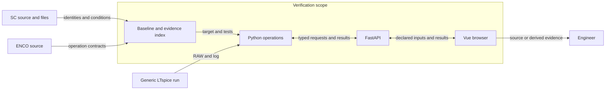
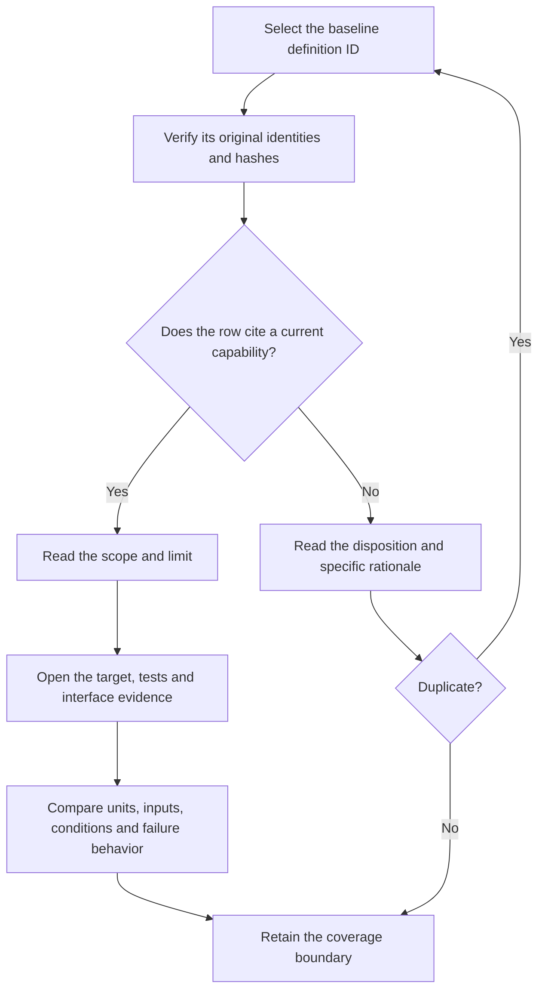

# Semiconductor workflow verification against SC and ENCO

Codex · 2026-11-10 · Released verification record · Version 1.0  
Audience: semiconductor engineers selecting a calculation, and maintainers checking its source, conditions and evidence.

## R. Revision history

Table R1 identifies the scope of this issue.

| Version | Date | Author | Change | Decisions |
|---|---|---|---|---|
| 1.0 | 2026-11-10 | Codex | First verification against the October inventory and the local web application | D-001, reporting method |

## 0. Executive summary

The local application covers the path from source data to bounded loss calculations, thermal response, comparison and export. Coverage depends on the data available at the requested operating point. The [verification index](semiconductor-parity-verification-2026-11-10.json) identifies the 25 reviewed capabilities, current Python definitions, interfaces, tests and limits.

The October inventory contains 385 SC, 1,746 ENCO and 1,013 current-package definitions across 505 files. All 314 entries from the earlier SC inventory reconcile. All six original digitizer gaps have a tested calibrated image workflow. The review found further gaps by examining individual source operations, including inverse gate-resistance sizing and electrical screening indices.

Five catalog sources contain 2,490 observations. The MAT archive contains 198 files. A fresh generic double-pulse simulation supplied 18,136 samples for an independent parser and native-export check. These results establish file handling, numerical behavior and data flow within the stated limits. Device accuracy requires measurements from the relevant device, circuit and operating conditions.

The frozen checkout passed 1,417 selected headless Python cases and all 368 Vue unit tests. Use the indexed operation and its limits to select a calculation. Full source-function equivalence remains unverified.

## 1. Context and scope

The comparison covers semiconductor workflows in SC and ENCO that can run in the local Python, FastAPI and Vue application. Figure 1 shows the verification boundary. The [accepted GUI decision](../adr/0001-local-web-gui-replaces-qt.md) defines the target.

**Figure 1.** Reference identities connect to independent Python operations and their interfaces. Uploaded data do not trigger a simulator run.

The source roots are `\\wsl.localhost\Ubuntu\home\tinix\claude_wsl\archive_ntbees2\sc` and `D:\OneDrive\claude\bhy\enco`. The review used the immutable inventory and inspected relevant source contracts. It did not execute or redistribute ENCO implementation bodies.

The current package index represents October 15. New Python targets belong to the November evidence index. General circuit design, repository management, documentation generation, passive components and arbitrary simulator orchestration are outside the semiconductor workflow.

## 2. Objectives

1. Account for all 3,144 October definition IDs exactly once.
2. Preserve all historical hashes, dispositions and duplicate references.
3. Identify current source and test evidence for every claimed operation.
4. Report zero unqualified claims of numerical equivalence based on a family or name.

## 3. Requirements

Table 1 gives the criteria for this review. The issue tracker owns implementation status after this date.

| ID | Requirement | Value or limit | Source | Priority |
|---|---|---|---|---|
| R1 | Preserve original identities | 505 files, 3,144 definition IDs, unchanged baseline SHA-256 | [Baseline](../sprints/semiconductor-function-gap-ledger.json) | Required |
| R2 | Use independent calculations | Conditions, units, source and limits for every scientific claim | [SC review](../sprints/sc-archive-parity-review.md) | Required |
| R3 | Keep science reusable | Python calculations callable without Qt, typed transport and browser evidence when applicable | [GUI decision](../adr/0001-local-web-gui-replaces-qt.md) | Required |
| R4 | Preserve scientific absence | Unknown, omitted, failed, estimated and computed zero retain distinct meanings | [Waveform contract](../api/waveform-workbench.md) | Required |
| R5 | Restrict conclusions to evidence | No extrapolation of a fixture to an unmeasured device | [Biela verification](../api/christen-biela.md) | Required |

**Table 1.** The five requirements qualify the inventory, implementation and scientific conclusions.

## 4. Method and repeatability

Follow Figure 2 for one baseline definition. The index retains the historical file location, declaration line and notebook cell where available. Its current target entries contain declaration lines, file hashes and definition-text hashes.

**Figure 2.** A current capability link leads to its testable contract. A duplicate leads to its original identity.

1. Open the repository root.
2. Run `python scripts/verify_semiconductor_parity_record.py`.
3. Select an ID in the [readable baseline inventory](../sprints/semiconductor-function-gap-analysis.md).
4. Find the same ID under `definitions` in the [index](semiconductor-parity-verification-2026-11-10.json).
5. Read the classification and its rationale.
6. For each capability reference, inspect the target definitions and evidence files.
7. Repeat the cited test with the same inputs, conditions and simulation provenance.

The checker reads the reviewed checkout. A changed target produces a mismatch. Current definition hashes use exact source bytes. The baseline keeps its original normalized Python or conservative MATLAB hash convention. The [inventory generator](../../scripts/build_semiconductor_gap_ledger.py) documents that convention.

Evidence tags distinguish measurement or inspection **[M]**, simulation **[S]**, calculation **[C]**, estimate **[E]** and assumption **[A]**. Test execution is an observation of software behavior. A simulator trace remains simulated physical evidence.

## 5. The inputs and operations have traceable coverage

### 5.1 All original identities remain available

Table 2 reports counts of definitions, including classes, properties, tests and duplicate copies. The November index retains October categories on a separate field.

| Source | Definitions | Interpretation |
|---|---:|---|
| SC | 385 | 314 original functions, 31 additional functions outside notebooks, four notebook functions and 36 classes |
| ENCO | 1,746 | Multiple package generations, source tests, semiconductor functions and system context |
| Current package | 1,013 | Historical definitions before subsequent work in this checkout |
| Total | 3,144 | One November row per original ID across 505 files |

**Table 2.** Original and expanded SC inventories reconcile, and every October ID has a November entry. [C]

The October inventory assigned 833 candidates, 848 reference-only entries, 688 duplicates, 617 Python-only entries, 148 stubs, six missing entries and four broken adapters. Duplicate identity remains available even when the implementation has a related workflow. No individual source definition receives a proof of unrestricted function equivalence. [C]

The inventory contains 2,771 function declarations and 373 class declarations. Forty-one declarations in four unparseable SC files retain a source-file hash and location, with null body and definition hashes. These include both archived Biela copies and the Python bridgeless example. Working replacements have independent evidence. [M/C]

The November index links 277 baseline rows to bounded capabilities. Of these, 235 come from SC or ENCO and 42 from the historical current package. Forty-seven rows also name specific current Python definitions. Other linked rows refer to an operation with several cooperating targets. The remaining rows record their own dispositions, such as duplicate, test, stub, context or unassessed current definition. [C]

### 5.2 The source workflow determines which calculation applies

Table 3 gives entry points for substantive source operations. The index provides qualified names, declaration lines, hashes, route definitions, Vue components and individual evidence files. Read each target with its stated domain.

| SC or ENCO operation | Current behavior and boundary | Evidence |
|---|---|---|
| SC MOSFET timing intervals, plateau and gate-current traces | RC/Miller charge intervals use declared gate rails and resistance. Timing alone cannot establish physical drain energy. [E] | [Gate timing](../../transistordatabase/analytical_models.py), [interval tests](../../tests/test_gate_charge_intervals.py) |
| SC `mfiles/calcRg.m`, ID `sc-92afe9737e47b855` | Invert the Miller current estimate for a target slew. The largest required resistance across the plateau interval sets the minimum total gate-loop resistance. [E] | [Resistance estimate](../../transistordatabase/gate_resistance.py), [inverse/forward checks](../../tests/test_gate_resistance.py) |
| Current public energy-versus-gate-resistance helpers | Interpolate within a uniquely applicable recorded curve, or invert for one bounded resistance crossing. The device and switching branch come from the caller's records. [C/E] | [Headless helpers](../../transistordatabase/rg_formula.py), [curve and inverse tests](../../tests/test_rg_formula.py) |
| SC IGBT linear fit, signed collector slew and terminal capacitance | Fit current/voltage samples in an explicit interval. Integrate capacitance over voltage. Report signed slopes and fit evidence. The archived diode fitting helper contains defective operations. [C/E] | [Parameters](../../transistordatabase/device_parameters.py), [numerical and API tests](../../tests/test_device_parameters.py) |
| SC Biela turn-on/off, transconductance and diode recovery | The Python model returns phase energies, convergence and model boundaries. Transfer fit voltage and recovery test current retain independent provenance. [C/E] | [Model and fixtures](../api/christen-biela.md), [extraction review](../../tests/test_extraction_independent_review.py) |
| SC two-pulse runner, RAW/log readers and switching-energy extraction | A generic two-pulse circuit supplies traces. Explicit mapping selects an event, polarity, voltage, current and window. Preserve every accepted input sample. [S/C] | [Netlist tests](../../tests/test_dpt_contract.py), [import review](../../tests/test_measurement_import_independent.py) |
| SC conduction, switching loss and transition sampling. ENCO directional loss and time series | Integrate signed piecewise-linear data using exact polynomial segments. Sample current before the event bracket. Bound lookup by direction and recorded conditions. [C] | [Waveform contract](../api/waveform-workbench.md), [tests](../../tests/test_waveform_workbench.py) |
| ENCO MOSFET/diode regressors, including two defective array-to-column wrappers | Independently evaluate conditioned tables and explicitly selected separable estimates. Preserve ambiguity, domain exits and missing branches. General ENCO training pipelines lack compatibility evidence. [C/E] | [Table evaluator](../../transistordatabase/condition_tables.py), [parameter tests](../../tests/test_device_parameters.py) |
| SC parallel devices, reverse conduction and IGBT/diode combinations | Scale an identical-device bank. Combine signed branches or select a reverse envelope with declared assumptions. Each device retains its source and conditions. [C/E] | [Assembly contract](../api/semiconductor-assemblies.md), [independent review](../../tests/test_phase6_independent_review.py) |
| SC junction temperature, thermal paths and current limits | Evaluate Foster networks, exact polynomial heat and event impulses. Require a physical owner. Explicitly select known-part heat when components are missing. [C/E] | [Thermal contract](../api/thermal-workbench.md), [handoff checks](../../tests/test_grid_energy_independent_review.py) |
| SC DAB, SRC-ZCS, SRC-ZVS, LLC, bridgeless, six-switch and rectifier helpers | Twelve role presets aggregate supplied waveforms or held envelopes. Secondary omissions, multiplicity and symmetry require declaration. ENCO-style custom roles require explicit inputs. [C/E] | [Preset contract and limits](../api/converter-losses.md), [independent tests](../../tests/test_converter_independent_review.py) |
| ENCO configuration/operating-point evaluation and group plots | Evaluate finite pairs with weights. Retain failed pairs, partial coverage, ties and metric direction. Display shared time cursor, spectrum and component watts. [C] | [Grid contract](../api/grid-analysis.md), [grid tests](../../tests/test_grid_analysis.py) |
| SC energy surface helpers and incomplete fixed reshape | Build conditioned current/voltage cells, source points and exclusions. Four valid displayed corners permit an explicitly selected bilinear estimate. [C/E] | [Map implementation](../../transistordatabase/energy_maps.py), [map tests](../../tests/test_energy_maps.py) |
| SC Pareto notebook and workbook relative cost | Calculate objectives from primary quantities. Preserve ties, fixed versus filtered normalization populations, and quote basis. A missing quote leaves electrical panels available. [C] | [Catalog contract](../api/catalog-fom.md), [independent checks](../../tests/test_fom_sources_independent_review.py) |
| SC workbook thermal-current, price, switching, IGBT differential-resistance and area indices | Ten named metrics use source or explicitly mapped operands. A selected constant-model thermal calculation uses the declared 100 °C case or heatsink boundary. [C/E] | [Workbook calculations](../../transistordatabase/workbook_fom.py), [source-row checks](../../tests/test_workbook_fom.py) |
| SC workbook files, Power Query and hyperlink macros | Preview source cells, units, formulas, caches and errors. Map or compare snapshots. Inspect hyperlinks independently of their formula cells. [M/C] | [Source contract](../api/catalog-sources.md), [source tests](../../tests/test_catalog_sources.py) |
| SC `analyze_image`, `DataPicker`, plotting and update helpers | Calibrate two independent axes on the source image. Linear, logarithmic and reversed scales preserve physical units and source hash. [C] | [Digitizer contract](../api/image-digitization.md), [independent tests](../../tests/test_digitization_independent_review.py) |
| SC `scData` versions, traces, source images and file save | Preserve source bytes and unknown fields. Map named branches and units explicitly. The semantic MAT5 exporter reports field-level loss. [M/C] | [MAT contract](../api/legacy-mat-data.md), [migration tests](../../tests/test_mat_migration_independent.py) |
| SC PLECS package fields and LUTs. ENCO XML importer and placeholder exporter | Read repeated and namespaced blocks. Preserve formula metadata. Export source-backed XML or explicitly selected physical core tables. [M/C] | [PLECS contract](../api/plecs-data.md), [round-trip tests](../../tests/test_plecs_document.py) |
| Current public working point, channel linearization and native formats | Select an exact unambiguous channel. Use bounded one-sided derivatives at endpoints. Produce native JSON, numeric MAT5, or condition-selected Gecko switch files. [C] | [Public tests](../../tests/test_public_calculation_exports.py), [export review](../../tests/test_public_export_independent_review.py) |
| Current comparison, search, static loss and ratings exports | Preserve recorded curves, report unknown thermal data, and keep unavailable power explicit. The static-duty estimate uses the waveform and converter engine. [C/E] | [Comparison contract](../api/legacy-comparison.md), [browser export cases](../../transistordatabase/gui_web/src/tests/e2e/native-export-downloads.spec.js) |

**Table 3.** Source operations lead to bounded current calculations or explicit data-preservation workflows.

For example, SC ID `sc-e89fae5a286227f3` identifies `matlab_func/calc_Pcond_Semi.m`, line 1. Its specific target is `waveform_losses.analyze_waveform`. The test `test_crossed_table_knot_and_cumulative_evidence` checks both the knot crossing and cumulative energy. Independent branches, signed current and interval assumptions still qualify correspondence. [C] [Waveform implementation](../../transistordatabase/waveform_losses.py), [test](../../tests/test_waveform_workbench.py)

ENCO ID `enco-0ea4305913236e49` identifies `MOSFET.get_vf`. The archived wrapper uses an incompatible array interface. The current table evaluator requires a typed diode curve, bounded current and matching conditions. The original wrapper remains defective in the source record. [M/C] [Current table evaluator](../../transistordatabase/condition_tables.py), [condition tests](../../tests/test_device_parameters.py)

### 5.3 Numerical examples keep source and model conditions separate

Table 4 records values that distinguish valid behavior from plausible-looking output.

| Check | Input and result | Interpretation |
|---|---|---|
| Actual generic LTspice circuit | 18,136 samples. Turn-on 185.590903 µJ at 22.966204 A. Turn-off 179.600236 µJ at 19.913280 A. [S/C] | Integral of `V(sw) × Id(M_dut)`. External capacitor heat is outside this convention. Log temperature 27 °C did not establish junction temperature. |
| Biela constant-transconductance fixture | With 100 V and 10 A, turn-on is 67.707784 µJ and turn-off is 111.051183 µJ. The boundary current is 1.2 A. [C/E] | Equation and energy partition check. Commercial switching performance remains unmeasured. |
| Direct fitting and staged recovery | Transfer data at 10 V and 25 °C retain their conditions when applied to a 400 V model. Recovery measured/test input at 20 A remains separate from 10 A load. [C] | Crossing from extraction to simulation preserves source conditions and signed residuals. |
| Finite weighted grid | Complete fixture means are 25 W and 20 W. A failed pair leaves a 10 W successful subset with 0.25 weight coverage. [C] | Positive missing weight makes the full mean unavailable. |
| Conditioned energy map | Four supported corners produce 0.75 mJ at 5 A and 600 V. [E] | The value is a bounded estimate on the displayed grid. |
| Inverse gate resistance | With 100 pF and 20 V/ns, gate current is 2 A. Rails +15/−5 V and a 4–7 V plateau give 5.5 Ω on and 6 Ω off. [E] | Both values apply to total series resistance under the selected model. |
| Workbook IGBT row 2 | A 100 °C heatsink boundary gives 70.754717 W and a 45.602025 A conduction estimate. The source current rating is 100 A at 25 °C case temperature. [M/C/E] | The missing recovery coefficient excludes the voltage/coefficient benchmark. The source cache contains a value because Excel treats the blank cell as zero. |
| Linked waveform and Foster response | A 12 Hz spectral peak and a 17 W / 3 W component stack matched calculated values. The reverse-owner fixture returned `25 + 13/e` °C. [C] | Both handoff paths preserve heat owner, polynomial coefficients and event impulses. |

**Table 4.** Simulation, calculated fixture values and selected estimates retain distinct physical meanings. [Biela reference](../api/christen-biela.md), [grid and thermal review](../../tests/test_grid_energy_independent_review.py), [measurement review](../../tests/test_measurement_import_independent.py)

### 5.4 The format census distinguishes preserved data from calculable data

The five catalog sources comprise three workbooks and two CSV files. Eight imported populations contain 2,490 rows. The workbook audit identified nine sheets, 4,216 formula cells, one chart and 426 source errors. Five Power Query connections have three loaded tables. The historical relative-cost summary has 310 rows. [M] [Workbook census](../sprints/semiconductor-workbook-function-audit.md)

The macro-enabled workbook has five VBA modules and two substantive procedures. Stored hyperlinks cover 23 MOSFET and 36 IGBT cells. The 63 `GetURL` formulas form a separate population. Source refresh, macro execution and arbitrary formula evaluation have no verification claim. [M] [Workbook census](../sprints/semiconductor-workbook-function-audit.md)

Thermal-current/price and voltage-times-thermal-current/price use the selected current estimate and its historical quote. Switching benchmarks require three explicit coefficients in J/A. The test-voltage quotient has units Hz. It gives no maximum switching frequency. IGBT differential resistance uses a separate identity from MOSFET on-resistance. The area–thermal-resistance products require a declared area unit and the corresponding junction-to-fluid path. [C/E] [Workbook metric contract in code](../../transistordatabase/workbook_fom.py)

All 198 MAT files had identifiable formats. Of these, 174 use MAT5 and 24 use the supported Octave text container. The reviewed corpus contains 160 binary `scData` files and one complete Octave `scData` case. Other schemas have preview or archive scope. The index records every archive filename, size and SHA-256. [M] [MAT evidence and source census](semiconductor-parity-verification-2026-11-10.json)

### 5.5 Regression scope

The frozen checkout passed **1,417 unique Python cases in 45 files**, with zero skips, failures or errors, in 97.75 s. One warning concerns the installed Starlette/httpx test transport. Three NumPy warnings came from a deliberate numerical overflow rejection. The generic RAW fixture case ran. The test owner verified the 45 test and 39 production file hashes against the run inputs. [M]

The final Vue command passed **368 tests in 30 files** in 11.01 s. Four final compiled Chromium workflows passed in 30.5 s on the 174-module build. They covered actual workbook rows, mapped zero/missing fields, inverse resistance and late currency-response handling. On the IGBT row, a declared CHF quote at 1,000 units gave 3,989.41 V·A/CHF. The archive itself does not declare that currency. [M/C]

Ruff found zero issues in the package and focused source check. The whitespace diff check passed. With Qt imports blocked, the smoke check loaded the core transistor, 23 scientific modules and the FastAPI application with 85 routes. Legacy Qt tests and unrelated REST fixtures outside the reviewed headless selection are outside this result. The index preserves the per-file counts, hashes, warnings and run settings. [M] [Frozen run evidence](semiconductor-parity-verification-2026-11-10.json)

Table 4a records selected earlier test runs. Counts within a row refer to that run. A test can appear in several runs.

| Scope | Python or independent checks | Browser evidence |
|---|---|---|
| Gate timing, DPT, parameters | 84 timing tests, 82 DPT tests and 66 parameter tests in separate runs | Gate timing had six Vue tests and two compiled workflows. A separate DPT run used installed LTspice. |
| Biela, signed waveform | 116 Biela tests. A waveform run had 114 tests and an independent check made 1,720 assertions. | Each scope had six Vue tests and three compiled workflows. |
| Assemblies and thermal | 101 independent Python cases across the shared engine and adapters | 16 Vue tests, seven owner and four independent compiled cases |
| Catalog and source | 42 FOM tests and 40 independent source tests | FOM had seven Vue and five compiled cases. Source had eight Vue and four owner plus four independent compiled cases. |
| Digitization and MAT | 51 digitizer tests and 41 MAT tests in separate runs | Digitizer had seven Vue and six compiled cases. MAT had nine Vue and six compiled cases. |
| Extraction and measurement | 186 headless extraction tests. Measurement had 147 tests, including 31 independent cases. | Extraction had 24 Vue and six compiled cases. Measurement had seven Vue and nine compiled cases. |
| Grid, maps and linked thermal | 138 focused backend tests and seven independent API cases | Four independent compiled cases covered ranking, map, spectrum and thermal transfer. |
| Public models and exports | 324 focused and adjacent Python cases in one review. A separate independent review had 42 cases. | Four compiled desktop/mobile cases exercised actual downloads, comparison and missing values. |
| Workbook and gate resistance | Workbook checks passed 48 cases, including 14 independent cases. Public gate-resistance energy checks passed 144 cases, including eight independent cases. | The final four compiled workflows above include workbook and gate-loop sizing. Public energy-versus-resistance helpers have Python-only coverage. |

**Table 4a.** The recorded checks cover calculations, transport and rendered controls at different levels. [M]

## 6. Physical and format limits determine the usable scope

Decision D-001 applies to the reporting method. A source definition can correspond to a tested operation while the two have different assumptions, error handling or physical coverage. Table 5 identifies boundaries that affect interpretation.

| Boundary | What remains available | Unsupported or unverified behavior |
|---|---|---|
| Incomplete or defective source | Source hashes, separate historical dispositions and independently tested replacements | Correctness of empty SC stubs, defective diode fit, fixed-shape energy grid or ENCO scalar wrappers |
| ENCO infrastructure | Bounded tables, declared operating points, signed waveforms and optional spectra | General regressor training, model interchange, arbitrary series operations, complete multiconductor circuit design, autonomous optimizers or simulator pools |
| ENCO stress indices | Source IDs and index dimensions | Four historical proxies remain reference-only. They cannot be inferred from the current grid's four loss metrics in watts. |
| ENCO channel/diode split | Bounded reverse-voltage envelope and declared branch models | The historical trained-diode estimate uses a provisional voltage and a current subtraction. Physical current sharing requires different evidence. |
| Physical device or package | Exact-condition curves, signed channel segments and declared heat ownership | Universal measured accuracy, unspecified device parasitics, missing thermal networks or proof of soft switching from topology alone |
| Public gate-resistance energy helpers | Recorded data support bounded interpolation and unique inverse crossings in Python | Extrapolated resistance, missing evidence, ambiguous contexts or multiple inverse solutions have no unique answer. The helpers have no separate web operation. |
| Files and tools | Native JSON, supported MAT5/scData and Octave source archive, documented PLECS workflows, conditional Gecko switch SCL | MATLAB object/function/HDF5 conversion, general XML/struct equivalence, arbitrary SPICE device or Simulink block generation and universal simulator acceptance |
| Gecko diode effects | Seven condition selections and manifest retain the chosen switch evidence | Forward-recovery behavior without a corresponding data model |
| Catalog and source | Currency/quantity cohorts, original cells, errors, units and links | Historical price conversion, unrecorded unit assumptions and arbitrary formula or query execution |
| Image geometry | PNG/JPEG calibration up to 8 MiB, 8,192 pixels per side, 16 million pixels and 20,000 points | Automatic curve recognition, perspective correction, unsupported orientation and higher input sizes |
| Measurements | Explicit CSV, RAW and log parsing up to 8 MB, 100,000 samples, 500,000 cells and 10,000 log records | Implicit unit inference, automatic database writes or simulator execution after upload |
| Grid and maps | Up to 32 configurations, 64 points and 256 pairs. Input 4 MB, response 24 MB. | Extrapolation, ambiguous corners, silent omission of failed weight or fictitious heat |
| Browser | Verified compiled desktop and mobile Chromium workflows | Firefox, Safari, arbitrary device displays and independent vendor application acceptance were not verified |

**Table 5.** Unsupported operations stay identifiable at the point where data, model or format coverage ends.

The ENCO conduction proxy is squared RMS current [A²]. Its volume proxy multiplies that value by squared maximum drain-source voltage [A²·V²]. Its cost proxy is `1 / (R_on × V_DS,max²)` [1/(Ω·V²)]. Its switching proxy sums event frequency times squared drain current times drain-source voltage [Hz·A²·V]. These dimensions differ from watts, physical volume and quoted currency. [C] [Source identities and explicit limits](semiconductor-parity-verification-2026-11-10.json)

## 7. The evidence supports bounded use

Table 6 gives the confidence for each conclusion.

| # | Conclusion | Basis | Confidence | Evidence |
|---|---|---|---|---|
| 1 | Every October definition has a stable, traceable November record. | C | High | Table 2, [identity checker](../../scripts/verify_semiconductor_parity_record.py) |
| 2 | Current source and tests identify the accepted physical inputs and failure modes for the reviewed operations. | M/C | High within the tested domains | Tables 3–4 and indexed tests |
| 3 | Native evidence retains conditions and source bytes where the relevant format permits them. | M/C | High for the recorded fixtures | Section 5.4, [native serialization tests](../../tests/test_core_native_serialization.py) |
| 4 | Reference operations correspond to bounded current workflows at capability level. | C/E | Medium for the source-to-target interpretation | Tables 3 and 5, per-ID rationale |
| 5 | Commercial-device switching accuracy remains unverified. | A | No measured accuracy estimate | Generic model and algebraic fixtures in Table 4 |

**Table 6.** Confidence in identity, software behavior and physical prediction depends on different evidence.

## 8. Next use of the record

Table 7 identifies follow-up actions triggered by future use. It creates no implementation commitment.

| # | Action | Owner | Due date |
|---|---|---|---|
| 1 | Verify the indexed hashes before using this record for a changed checkout. | Reader | At reuse |
| 2 | Supply device measurements and declared conditions for a commercial accuracy claim. | Device-model owner | At device qualification |
| 3 | Select the exact source, simulator version and target model before a compatibility claim. | Export consumer | At interoperability qualification |

**Table 7.** Future qualification depends on the device, format or checkout under review.

## 9. Decision log

### D-001. Preserve the baseline and record capability evidence separately

**Date** 2026-11-10 · **Version** 1.0 · **Scope** Verification method only.

The October baseline predates the implementation. A separate dated index preserves all original observations and supports independent checks against new files. Table 8 compares the reporting methods [C]. The existing GUI architecture decision remains the source for the implementation boundary.

| Option | Benefit | Limit | Verdict |
|---|---|---|---|
| Preserve the baseline and add a dated index | Reconciles 3,144 immutable IDs and fingerprints current evidence separately | Requires one ID lookup across two files | Selected |
| Regenerate the baseline against the new checkout | Provides current declaration lines in a single inventory | Replaces historical current-package hashes and changes the comparison population | Rejected |
| Treat a family match as functional parity | Reduces mapping effort | Gives no equation, domain, source-condition or failure evidence | Rejected |

**Table 8.** The selected method preserves source identities and makes evidence drift detectable.

## 10. References and appendices

The [machine-readable verification index](semiconductor-parity-verification-2026-11-10.json) is the complete per-definition appendix. The [readable October inventory](../sprints/semiconductor-function-gap-analysis.md) gives original function names and locators. The [October JSON baseline](../sprints/semiconductor-function-gap-ledger.json) retains original signatures, notebook cells, candidate targets and parser limitations.

The [first SC inventory](../sprints/sc-archive-function-inventory.json), [SC capability review](../sprints/sc-archive-parity-review.md) and [workbook audit](../sprints/semiconductor-workbook-function-audit.md) supply historical comparison data. The [GUI decision](../adr/0001-local-web-gui-replaces-qt.md) defines the scope boundary.

For local startup and user-facing operations, use the [web application instructions](../../transistordatabase/gui_web/README.md). The [package declaration](../../pyproject.toml) records the runtime and optional dependencies.

### Appendix A. Evidence dictionary

**Identity.** The baseline SHA-256 is `d744750e9bd140e0f6b61af3dcd7f8735ee954a5be799f73a8a7268a17651c71`. The MAT corpus fingerprint is `75fb1ff7951defd709175bd944fd7ea3284730d91387f7bd526a16da4b303206`. The simulated RAW file SHA-256 is `f851fb950bc03212585657b37d187d8ba9f18bd2ffd2aefe396ff8c0335dcca2`.

**Reading the JSON.** Use `definitions[id]` for the original locator and November interpretation. Follow `capability_refs` to `capabilities`. Follow its target IDs to `targets`, and its source, test and interface paths to `files`. The supplemental workbook sources and MAT census have separate identities.

**Repeating the measured run.** Select the project's existing `ntbees2` environment. For the fixture-specific case, set `TDB_GENERIC_DPT_RAW` to the original RAW file identified above. An independent simulation can produce a different file hash. Source-corpus checks also require access to the SC archive. Run the indexed Python files with `pytest --noconftest -p no:cacheprovider` and a new, unused temporary directory. This bypasses the legacy Qt test setup. Consult the [measurement test](../../tests/test_measurement_import_independent.py) for the exact trace names and time span.

**Terminology.** SC denotes the semiconductor archive. ENCO denotes the comparison project. FOM means figure of merit. DPT means double-pulse test. LUT means lookup table. FFT means fast Fourier transform. RC means resistance–capacitance. DAB means dual active bridge. SRC denotes a series-resonant converter. ZCS and ZVS mean zero-current and zero-voltage switching. MOSFET and IGBT identify semiconductor device types. SI denotes the International System of Units.
