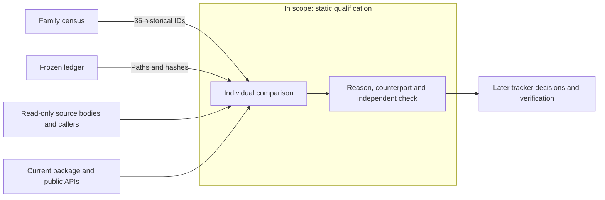

# Reference qualifications distinguish operations, defects, and missing data

Codex · 2026-11-11 · Status: In review · Version 1.0  
Audience: Reviewers who reconcile source qualifications with application work.

## R. Revision history

| Version | Date | Author | Change | Decisions |
|---|---|---|---|---|
| 1.0 | 2026-11-11 | Codex | First 35-ID source-body qualification annex | D-001 |

## 0. Executive summary

The audit inspected 35 definitions in seven frozen source files. All seven file hashes matched the ledger [C]. These records do not establish 35 missing physical operations.

The current package has the bridgeless calculation and the named `sc-bridgeless` preset. The source wrapper consumes supplied waveforms. It generates neither waveforms nor control. It contains no thermal feedback. Four unresolved caller data files limit historical circuit qualification.

Analytical records include constructors, incomplete wrappers, and a zero-return stub. Current Biela extraction and phase calculations have bounded contracts. Measured-device accuracy requires separate observations.

Median statistics, rolling-mean baseline removal, periodic shifting, and Hamming/Blackman windows form one bounded conditioning group. Continuous-temperature diode prediction is another functional difference from current exact-condition slices. Its physical accuracy separately requires held-out measurements.

This audit imported no source and ran no numerical tests. The issue tracker owns later work and live status.

## 1. Context and idea

This annex records source inspection against application commit `e41cc8a`. It retains the original 19 analytical and 16 signal/calibration qualification IDs. Census refinements do not alter those historical cohorts.

Figure 1 shows the inspection boundary. The companion [JSON](semiconductor-reference-qualification-2026-11-11.json) retains exact source paths, lines, hashes, counterpart symbols, and proposed checks.

*Figure 1. Each qualification requires source identity and an individual comparison.*

## 2. Objective

The target is 35 unique records with a reason, current counterpart, remaining qualification, and independent check. The target is zero source-file hash mismatches.

## 3. Requirements

Table 1 states the audit limits.

| ID | Requirement | Value or limit | Source | Priority |
|---|---|---|---|---|
| R1 | Account for every selected ID | 35 unique records | Historical census cohorts | Required |
| R2 | Retain source identity | 0 file-hash mismatches | Frozen ledger | Required |
| R3 | Separate operations and source defects | One reason per ID | Review scope | Required |
| R4 | Preserve source data and runtimes | Read-only inspection | User authorization | Required |

*Table 1. Individual records do not require source execution.*

## 4. Method

1. Join each selected ID to the frozen ledger.
2. Inspect its source body and relevant callers.
3. Search the current package for calculation and API counterparts.
4. Verify each source-file hash.
5. Record an independent check for each qualification.

The [C] tag identifies static comparisons or arithmetic checks. Proposed checks did not run. A matching counterpart does not establish numerical parity or measured-device accuracy.

The read-only source roots are `/home/tinix/claude_wsl/archive_ntbees2/sc` and `D:\OneDrive\claude\bhy\enco`. No reference bodies were copied into application code.

## 5. Existing bridgeless calculations consume the source fields

Table 2 gives the exact source mapping. The current preset retains these signs and physical-member counts [C].

| Role | Current | Duty | Frequency | Physical members |
|---|---|---|---|---|
| MOSFET | `iac` | `dn1` | `fs` | `s1`, `s2` |
| PFC diode | `-iac` | `dp1` | `fs` | `idpfc1`, `idpfc2` |
| Reverse IGBT | `-iac` | `dp1` | `0` | `isrev1`, `isrev2` |

*Table 2. The existing `sc-bridgeless` preset retains two members per source role.*

The source consumes `t`, `vdc`, `iac`, `dn1`, `dp1`, `fs`, and `P`. It copies `Vac`, `Vdcmax`, `fl`, `C`, and device names. It returns nine per-device conduction/on/off power vectors. It calculates arithmetic sample means and multiplies each mean by two.

Current `converter_losses.analyze_converter` calculates component energy and duration-based mean power. It retains scaled member totals, bindings, models, and assumptions. Custom bindings accept supplied signed branches. Current `circuit_summary.analyze_circuit_summary` adds explicit die/junction heat ownership and independent fixed-sink thermal paths.

The public boundaries are `POST /api/converters/analyze` and `POST /api/converters/circuit-summary`. The named preset is at `converter_losses.py:82–91`. The source wrapper generates no operating-point waveforms, control, or electrothermal feedback.

The source activates reverse IGBTs only for negative net power. The current preset discloses this source assumption. Nonnegative net power does not prove physical inactivity. Use explicit custom bindings when supplied branch currents contradict that assumption. Keep omitted contributions unknown.

An earlier inline claim of a missing bridgeless workflow was incorrect. Whole-package inspection found the existing calculation and named preset. This wrapper establishes no new PFC solver requirement.

The historical caller references four unresolved MAT files. They are `waveforms.mat`, `Infineon_IPW65R048CFDA.mat`, `ROHM_SCS220AE2HR.mat`, and `AIGW40N65F5.mat`. Their absence limits input conversion and historical circuit-accuracy qualification.

## 6. Missing operations form bounded groups

Decision D-001 keeps operations separate from wrappers, defects, and accuracy qualifications. Table 3 compares the audit alternatives.

| Option | Traceability | Risk | Verdict |
|---|---|---|---|
| Individual comparison | Retains all 35 source identities | Requires explicit support limits | Selected |
| Count labels as missing features | Retains only the count | Ports wrappers and source defects | Rejected |
| Infer full parity from family coverage | Retains broad families | Hides differences and missing data | Rejected |

*Table 3. Individual qualification avoids inflated gaps and unsupported parity.*

Conditioning group 11 contains median statistics, rolling-mean baseline removal, periodic sample shifting, and Hamming/Blackman options. These are distinct from existing global-mean detrending and rectangular/Hann transforms. The group is one bounded extension, not six independent physical solvers.

Source defects are not port targets. These include fabricated warm-up zeros, negative-shift tail errors, identifier lists, unchanged derivative units, Nyquist doubling, and fixed finite-window gain corrections.

Continuous-temperature diode query is functional extension 12. Current `device_model_fitting` requires an exact temperature/gate slice. `condition_tables.MeasuredTable` does not interpolate temperature implicitly. Legacy nearest-condition selection does not provide a continuous-temperature model.

A new opt-in bounded I/T model can address that query difference. Its physical accuracy requires separate held-out measurements. A proposed bilinear model needs training-only rectangle support, full rank, monotone current response, bounded inverse queries, and source conditions. This audit does not implement that model.

## 7. Conclusions retain the source limits

Table 4 records the conclusions and their evidence.

| # | Conclusion | Basis | Confidence | Evidence |
|---|---|---|---|---|
| 1 | All 35 IDs have individual records | C | High | Appendix A and JSON |
| 2 | All seven frozen source hashes match | C | High | JSON source-file joins |
| 3 | Bridgeless core and named preset exist | C | High | Table 2 and source mapping |
| 4 | Conditioning and continuous-T queries are bounded functional differences | C | High for the inspected boundary | Section 6 and Appendix A |
| 5 | Device and historical circuit accuracy need independent data | C | High for the limitation | Source examples and unresolved caller inputs |

*Table 4. Static correspondence does not establish measured-device accuracy.*

## 8. Next steps

Table 5 assigns follow-up review work. The tracker owns scheduling and live status.

| # | Action | Owner | Due date |
|---|---|---|---|
| 1 | Reconcile classifications with tracker decisions | Parent orchestrator | TBD |
| 2 | Define bounded conditioning checks before implementation | Implementation owner | TBD |
| 3 | Define continuous-T model support and held-out qualification | Model owner | TBD |
| 4 | Supply historical circuit and measured device inputs | Data owner | TBD |

*Table 5. Later work requires separate verification.*

## 9. Decision log

### D-001: Retain individual qualifications without inflating feature counts

**Date:** 2026-11-11. **Version:** 1.0. **Supersedes:** None.

**Context:** Historical labels mix invalid source, wrappers, calculations, and data-dependent accuracy.

**Decision:** Retain all 35 IDs and compare each inspected behavior with its current counterpart.

**Why:** Inspection found current Biela calculations and an existing bridgeless preset [C, Section 5]. It also found specific functional differences.

**Options considered:** Table 3 records the selected approach and two alternatives.

**Consequences:** A counterpart name proves neither numerical parity nor physical accuracy. Later evidence must state support, conditions, and source data.

## 10. References

- [Family census](semiconductor-reference-family-census-2026-11-11.json).
- [Frozen source ledger](../sprints/semiconductor-function-gap-ledger.json).
- [Earlier verification](semiconductor-parity-verification-2026-11-10.json).
- [Current Biela contract](../api/christen-biela.md).
- [Polars standard deviation](https://docs.pola.rs/api/python/stable/reference/expressions/api/polars.Expr.std.html). Default `ddof=1` confirms the sample-SD check.
- [NumPy real FFT](https://numpy.org/doc/stable/reference/generated/numpy.fft.rfft.html). Even and odd sample counts have different final-bin semantics.

The ETH manuscript fetch returned HTTP 403. No new paper-level accuracy claim is made.

## Appendix A. All 35 definitions retain individual qualifications

Table 6 gives the complete list. Counterpart keys resolve to paths, symbols, and public APIs in the companion JSON. Source-file keys resolve to exact frozen hashes there. Every independent check below is proposed and did not run in this audit.

| Reference ID and source symbol | Classification and current counterpart | Remaining qualification and independent check |
|---|---|---|
| `sc-57d89374475bf66f` `SwitchingLosses:13` | Representation wrapper. `B-params` | Conditions only. Check explicit parameter round-trip. |
| `sc-9f694d4de236ea48` `SwitchingLosses.__init__:14` | Representation wrapper. `B-params` | Hard-coded conditions. Check retained voltage, current, resistance, frequency, and temperature. |
| `sc-17690125051ce0a1` `Datasheet_C2M0080120D:30` | Data qualification. `B-device` | Empty device curves. Check traceable C(V) records and independent charge integration. |
| `sc-c0e84e8655acbe32` `Datasheet_C2M0080120D.__init__:31` | Data qualification. `B-cv`, `B-device` | Unexplained Qoss. Check original observations and charge convention. |
| `sc-bc6707dc266ec112` `Device:44` | Source defect. `B-device` | Incomplete assembly. Check same-condition coverage and missing-data rejection. |
| `sc-a3144d94d7ff6e5d` `Device.__init__:45` | Source defect. `B-device`, `B-rr`, `B-transfer` | Undefined inputs and invalid call. Check independent parameter extraction and provenance. |
| `sc-e43b733a1ea4694c` `Device.calc_reverse_recovery_params:72` | Defective source with counterpart. `B-rr` | Undefined T1. Check charge/lifetime residuals and measured recovery conditions. |
| `sc-ab9c6d13704feedb` `Device.calc_mosfet_capacitances:81` | Current counterpart. `B-cv` | Arbitrary resampling is unnecessary. Check constant/affine exact integrals and full coverage. |
| `sc-4b8bfa0bac76664f` `Device.calc_tau_c:102` | Zero-return source stub. `B-rr` | Check a nonzero independently constructed solution and residuals. |
| `sc-a1bda99de89e07a6` `Device.func_ich_vgs:107` | Current transfer-law counterpart. `B-transfer` | Check known coefficients and held-out fixed-condition observations. |
| `sc-ad7983bbef4ee3a3` `Device.calc_transconductance_parameters:110` | Defective source with counterpart. `B-transfer` | Mismatched filtering and gm expression. Check coefficients, rank, residuals, and support. |
| `sc-18ac352c082e0fc0` `Turnoff:129` | Incomplete source. `B-off` | Undefined helpers. Check independent phase-energy integration. |
| `sc-fa30eacd8d896423` `Turnoff.__init__:130` | Incomplete source. `B-off` | None energies. Check supported phases and explicit failure boundaries. |
| `sc-2982bc4fd160cb62` `Turnon:142` | Incomplete source. `B-on` | Check independent energy partitions and conditions. |
| `sc-6d7c711a1d361d8c` `Turnon.__init__:143` | Incomplete source. `B-on` | Undefined variables. Check phase fixtures, then measured double-pulse data. |
| `sc-b7aa76bbeb4c914c` `Turnon.__init__.calc_Ioss:163` | Defective source with counterpart. `B-miller` | Check algebraic roots, branch continuity, and nonlinear residuals. |
| `sc-36e1d7afc4a112d8` `Turnon.__init__.calc_ETon:168` | Defective source with counterpart. `B-on` | Undeclared trs. Check independently integrated phase energy. |
| `sc-b1a5c0f1f3775262` `run_example_device_C2M0080120D:203` | Data qualification. `B-device`, `B-model` | No numerical result or sourced Qoss. Check traceable device data and measurements. |
| `sc-b49c7a95ee0fe10d` `SCLosses:1` | Existing core and named preset. `C-converter`, `C-summary` | MAT conversion and source accuracy remain unverified. Check signed branches, two-member totals, and explicit active paths. |
| `enco-1b0ca1e95642c124` `Component.set_regressor:256` | Storage wrapper. `F-train` | Check object/model identity and serialization, not physical calibration. |
| `enco-3a77e4447277a34f` `Component.get_regressor:263` | Lookup wrapper. `F-evaluate` | Forwarded model access is valid. Check present/absent labels. |
| `enco-ad519af300c25ffb` `Component.get_regressed_values:273` | Prediction dispatch. `F-evaluate` | Check bounded in-support predictions and support exits. |
| `enco-c874229cdc9d1e0e` `Diode.train:55` | Functional extension plus data qualification. `F-train`, `F-evaluate` | Continuous-T queries differ from exact slices. Check bounded bilinear coefficients/inverse, holdout separation, and measured residuals. |
| `enco-f6c3f7c1808b2c3f` `FrequencySeries.std:276` | Default identifier defect. `W-stats`, `W-spectrum` | Declare magnitude/real/imaginary quantity. Check sample SD on finite bin values. |
| `enco-7e98da276cf257cb` `FrequencySeries.median:280` | Identifier defect plus median extension. `W-stats`, `W-spectrum` | Same bounded median group. Check named finite values and null policy. |
| `enco-f29f7269e0740345` `FrequencySeries.harmonics:288` | Current full bins, display qualification. `W-spectrum` | Top-ten selection differs. Check more than ten bins, equality, and zero input. |
| `enco-c97b0c80096bf358` `SeriesContainer.std:546` | Current sample-statistic counterpart. `W-stats` | Check `[1,2,3]` gives sample SD 1. Keep sample/time-weighted meanings distinct. |
| `enco-c353741255894641` `SeriesContainer.median:558` | Bounded median operation absent. `W-stats` | Check finite odd/even sample counts and null policy. |
| `enco-28ccf411a17e82c7` `SeriesContainer.derivative:726` | Current interval counterpart. `W-derivative` | Source first-row null differs. Check affine and irregular-interval slopes and coordinates. |
| `enco-c12d331bf0910806` `SeriesContainer.time_to_frequency:948` | Existing FFT plus window extension. `W-spectrum` | Hamming/Blackman options differ. Check DC, even/odd endpoints, coherent gain, and Parseval. |
| `enco-ca9f358ffd96dbcb` `TimeSeries.std:156` | Current statistic wrapper counterpart. `W-stats` | Check finite sample SD and declared support. |
| `enco-5d251877286fba80` `TimeSeries.median:160` | Same bounded median operation. `W-stats` | Check finite odd/even values, units, and null policy. |
| `enco-ffd6d21447021585` `TimeSeries.derivative:208` | Wrapper identity/unit defects. `W-derivative` | Check N−1 interval placement, affine slope, and units per second. |
| `enco-59ea8bb3cf7f68bf` `TimeSeries.shift:232` | Bounded shift operation absent. `W-stats`, `W-spectrum` | Do not copy negative-tail defects. Check `[1,2,3,4]` shifted by one gives `[4,1,2,3]`. |
| `enco-fc8d3f8a475a36d6` `TimeSeries.detrend:249` | Bounded rolling-mean operation absent. `W-stats`, `W-spectrum` | Do not copy warm-up zeros or ID lists. Check independent rolling means and incomplete support. |

*Table 6. All 35 records retain separate operation, source-defect, and data qualifications.*
