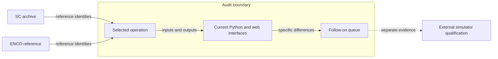
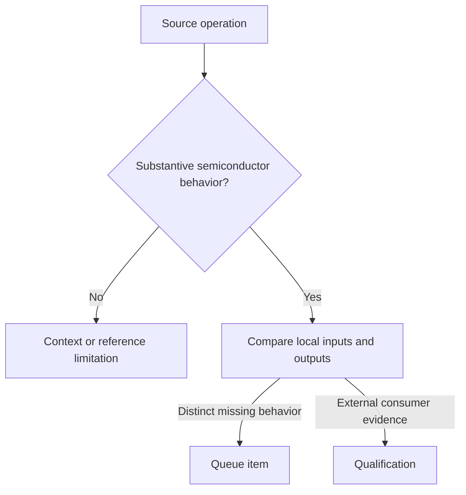

# Ten remaining SC and ENCO semiconductor workflows

Codex · 2026-11-10 · Released audit appendix · Version 1.1  
Audience: engineers selecting the next implementation or checking a source contract.

## R. Revision history

| Version | Date | Author | Change | Decision |
|---|---|---|---|---|
| 1.0 | 2026-11-10 | Codex | Identified ten follow-on workflows against the released snapshot | D-001 |
| 1.1 | 2026-11-10 | Codex | Corrected grouped time statistics and frequency-bin selection in row 8 | D-001 retained |

## 0. Executive summary

The review identified ten follow-on workflows. Four concern device calculations, two concern file or display interfaces, and four concern analysis or access to existing code. The first three are electrical stress indices, gate-state current allocation and reverse current sharing. Thirty source-definition references identify the inputs and outputs in the [machine-readable queue](semiconductor-remaining-gaps-2026-11-10.json).

This appendix describes the November 10 released snapshot before follow-on implementation. A later code change can change source hashes in its verification checker. The original report and ledger retain their historical evidence. Check current code and issues for subsequent changes.

## 1. Context and scope

Figure 1 identifies the comparison boundary. The October inventory contains 3,144 definitions. The released report verified selected contracts for 25 capabilities. This investigation examined substantive operations within and beyond those capability descriptions.

**Figure 1.** The queue links source operations to observable local interfaces. Simulator acceptance requires separate evidence.

## 2. Objective

For each queue entry, identify at least one definition ID, the input and output, the existing local implementation and the missing behavior.

## 3. Requirements

| ID | Requirement | Value or limit | Source | Priority |
|---|---|---|---|---|
| R1 | Preserve historical identities | Exact definition IDs and locators | October inventory | Required |
| R2 | Bound each finding | One declared workflow and explicit local overlap | Released verification index | Required |
| R3 | Protect reference material | Local source inspection only for ENCO | Reference access instructions | Required |

**Table 1.** Each finding requires traceable evidence for its source and local scope.

## 4. Method

1. Locate the definition in the immutable October inventory.
2. Read the reference operation and its initial classification.
3. Inspect the related local implementation and public interface.
4. Record the observed difference and separate qualification work.

**Figure 2.** The method excludes duplicate code, defective adapters and unsupported claims from the implementation count. Findings tagged **[M]** are source inspections.

## 5. Ten workflows have specific follow-on work

| Order | Workflow | Difference at review [M] |
|---|---|---|
| 1 | Electrical stress indices | The four ENCO helpers calculate screening proxies from device waveforms and declared parameters. The frozen waveform interface lacks their complete set. |
| 2 | Gate-state current allocation | ENCO returns two signed traces from a binary gate mask. Local event detection uses the gate to find transitions. |
| 3 | Reverse channel and diode current sharing | ENCO estimates diode current from an inferred voltage. The local envelope selects the lower drop. A simultaneous solution needs a separate model. |
| 4 | Energy versus gate resistance | Two existing Python helpers calculate bounded forward and inverse queries. The frozen interface lacks browser access. |
| 5 | Device model training | ENCO trains resistance, forward/inverse diode and switching-energy models. Local tables accept prepared inputs. A fit workflow needs traceable diagnostics. |
| 6 | Three-column energy-map import | SC reads coordinate triples onto a regular grid. Local energy maps require prepared slices and explicit conditions. Preserve missing cells. |
| 7 | Three-axis energy display | SC renders switching-energy surfaces and scatter points. The local workbench provides a heatmap, source points and tabulated results. |
| 8 | Thresholded spectrum and grouped series export | ENCO exports sample statistics per time series and up to ten qualifying frequency bins per spectrum. Local grid CSV contains loss summaries. |
| 9 | Multi-indicator ranking | ENCO combines normalized indicators across configurations. The local waveform grid ranks one selected power metric. |
| 10 | Circuit loss and thermal summary | ENCO attaches physical device losses and maximum junction temperature to a circuit. Local converter and thermal calculations have separate inputs and results. |

**Table 2.** The [queue](semiconductor-remaining-gaps-2026-11-10.json) gives each row’s reference ID, path, symbol, line, inputs, outputs and local evidence.

## 6. Source behavior determines the scope

The cost and volume indices are electrical proxies. Real purchase price and package dimensions require separate source data. The two current-allocation models answer different questions. A gate mask partitions a trace by command state. An equal-voltage branch model must also conserve current within the available data.

The grouped time export reports minimum, maximum, arithmetic sample mean, sample standard deviation and discrete root mean square (RMS). The local waveform mean and RMS use piecewise-linear integration over time.

ENCO selects bins with magnitude strictly above a fraction of the spectrum maximum. The fraction defaults to 0.1. Its grouped export takes the first ten qualifying bins in frequency order. The label *harmonics* conveys no test for integer multiples of a fundamental. Preserve one-sided Nyquist scaling and use a quadrant-aware phase calculation. A multi-indicator rank needs explicit normalization and coverage. Fit diagnostics should distinguish training residuals from independent prediction error.

The twelve local converter presets aggregate supplied signals. SC’s DAB semiconductor-loss routine consumes waveforms. Separate local buck, boost and buck-boost operating-point calculations exist. Full circuit waveform generation and general optimization remain separate scope. [Converter contract](../api/converter-losses.md)

The local digitizer already maps manual points with independent linear or logarithmic axes. The examined SC DataPicker also uses manual points. Automatic trace recognition has no demonstrated source contract here. PLECS and Gecko exports need independent consumer qualification for a version-specific acceptance claim. [PLECS contract](../api/plecs-data.md)

| Option | Traceability | Limitation | Verdict |
|---|---|---|---|
| Compare individual operations | Links each result to a declaration and local contract | Selective coverage | Use under D-001 |
| Count all unlinked definitions | Covers the inventory quickly | Includes duplicates, infrastructure and placeholders | Exclude from gap count |

**Table 3.** Individual operation contracts support the workflow count.

## 7. The evidence supports a bounded queue

| # | Conclusion | Basis | Confidence | Evidence |
|---|---|---|---|---|
| 1 | The gate mask and reverse current model require separate fixtures. | M | High | Rows 2–3 |
| 2 | Existing computations reduce the interface work for gate-resistance queries. | M | High | Row 4 |
| 3 | Grid extensions can reuse existing weighted coverage and returned sample data. | M | Medium | Rows 8–9 |

**Table 4.** Confidence applies to the inspected software contracts. The audit performed no device measurements.

## 8. Next steps

| # | Action | Owner | Due date |
|---|---|---|---|
| 1 | Verify each electrical index against a hand fixture and invalid inputs. | Implementer | TBD |
| 2 | Verify gate masks and reverse branch sharing independently. | Implementer | TBD |
| 3 | Reconcile later fixes against each dated queue entry. | Maintainer | TBD |

**Table 5.** Follow-on verification can proceed one contract at a time.

## 9. Decision log

**D-001 · 2026-11-10 · Version 1.0.** Count a substantive user workflow once. Individual operations preserve physical meaning. Counting raw definitions gives faster inventory totals but includes duplicate generations and accessors. The count is selective, with scope and evidence in Table 2.

## 10. References

- [October definition ledger](../sprints/semiconductor-function-gap-ledger.json)
- [Released November verification](semiconductor-parity-verification-2026-11-10.md)
- [Dated queue with exact source and local locators](semiconductor-remaining-gaps-2026-11-10.json)
